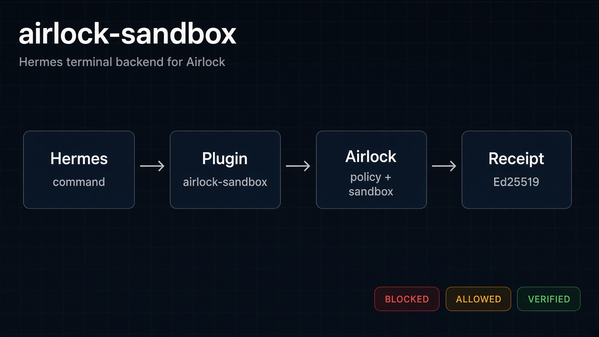
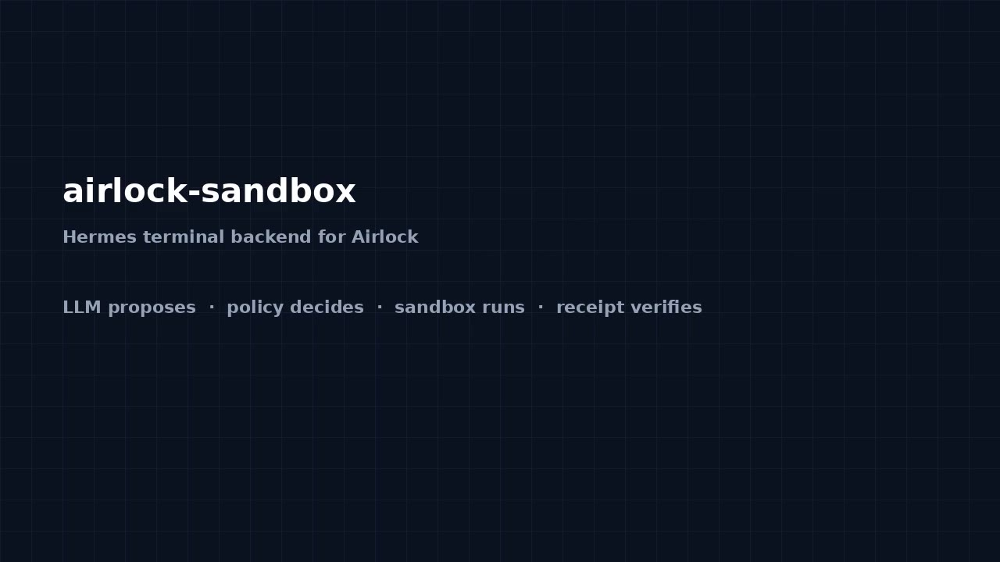

# airlock-sandbox

[](LICENSE)
[](pyproject.toml)
[](https://github.com/NousResearch/hermes-agent)



A Hermes Agent terminal backend. Terminal, `execute_code`, and file-tool commands
leave Hermes through this plugin, hit an [Airlock](https://github.com/justrunme/airlock)
HTTP API that I configure myself, and come back as **BLOCKED**, **ALLOWED**, or
**VERIFIED**. Airlock's policy engine decides allow or deny. Allowed code runs in
Airlock's disposable Docker sandbox, not on the Hermes host. Every decision includes
a signed receipt (RFC 8785 JCS, SHA-256, Ed25519). **VERIFIED** means that single
receipt's hash and signature checked out under a public key I configured locally.

This is a loadable plugin (`plugin.yaml` plus `register(ctx)`). It is not a prompt
wrapper or a skill. It hooks Hermes through the official terminal environment
provider seam: `ctx.register_terminal_environment_provider(...)`.

## Demo (opt-in)

[](https://github.com/justrunme/hermes-airlock-plugin/blob/main/docs/video/airlock-sandbox-demo.mp4)

A short recording against my public Airlock demo. The demo host and signing key are
**not** plugin defaults — you must set `base_url` and `public_key_hex` yourself.
Open [the demo on GitHub](https://github.com/justrunme/hermes-airlock-plugin/blob/main/docs/video/airlock-sandbox-demo.mp4)
to play it (~30 seconds). The voiceover is TTS, not my voice.

## Install

```bash
hermes plugins install /path/to/hermes-airlock-plugin
# or from git after I publish a pin:
# hermes plugins install https://github.com/justrunme/hermes-airlock-plugin
hermes plugins enable airlock-sandbox
hermes config set terminal.backend airlock_sandbox
```

Requires Hermes `>=0.21.6` (terminal environment provider API).

## Configure (required trust material)

Settings live under `plugins.entries.airlock-sandbox.settings` (also editable in
the Desktop Plugins form from `config_schema`).

| Key | Default | Purpose |
|-----|---------|---------|
| `base_url` | *(empty, required)* | HTTPS Airlock API base. **No built-in host.** |
| `public_key_hex` | *(empty, required when verifying)* | Trusted Ed25519 key (64 hex chars), obtained out-of-band |
| `timeout_s` | `60` | HTTP timeout |
| `verify_receipts` | `true` | Fail closed on bad hash/signature; requires `public_key_hex` |
| `language` | `bash` | Arena language (`bash` or `python`) |
| `api_token` (secret) | unset | Optional `AIRLOCK_API_TOKEN` for a private Airlock |

Example (replace with your own endpoint and key):

```bash
hermes config set plugins.entries.airlock-sandbox.settings.base_url "https://airlock.example.internal"
hermes config set plugins.entries.airlock-sandbox.settings.public_key_hex "<64-hex-chars>"
```

Opt-in sample against my public demo (labelled sample only — not defaults):

```bash
# DEMO ONLY — review the key yourself before trusting it
hermes config set plugins.entries.airlock-sandbox.settings.base_url "https://45-77-141-253.sslip.io"
hermes config set plugins.entries.airlock-sandbox.settings.public_key_hex \
  "d8c2acc2972692ee205a7e056d8ae2791906ba1e17f9bdf2cee14baf53377748"
```

I read the optional token only through `agent.secret_scope.get_secret("AIRLOCK_API_TOKEN")`.
I never open `.env` or Hermes `auth.json` myself. I never fetch the verifying key
from Airlock during verification — a server that could forge receipts could also
serve a matching key.

## How execution is hooked

1. Hermes loads this plugin and calls `register(ctx)`.
2. I register `AirlockSandboxProvider` with
   `ctx.register_terminal_environment_provider`.
3. When I set `terminal.backend: airlock_sandbox`, Hermes routes `terminal`,
   `execute_code`, and file tools through my `AirlockEnvironment.execute()`.
4. Before any network call I require a clean HTTPS origin `base_url` and (when
   verifying) a local `public_key_hex`. Missing, `http://`, userinfo, query,
   fragment, or bad ports fail closed.
5. Each command is posted to Airlock `POST /api/arena`. On allow, Airlock runs it
   in its sandbox. On deny, nothing starts there. Redirects are refused so an
   HTTPS POST body cannot be replayed onto another origin or HTTP.
6. I verify the receipt under my local key, then bind signed `decision.verdict`
   and `execution.{exit_code,stdout_sha256,stderr_sha256}` to the outer arena
   fields before printing `BLOCKED` / `ALLOWED` / `VERIFIED`. Both digests must
   be present exact hex (schema-optional `stderr_sha256` absent/null refuses
   VERIFIED); `exit_code` must be an exact JSON integer (no float/bool/string
   coercion). Signature-OK alone does not authorize unbound outer fields.
7. Hermes dangerous-command approvals stay on (`skip_container_guards = False`).
   Airlock is an extra fail-closed gate, not a bypass.

### Limitations (honest)

- Airlock `/api/arena` has **no process-stdin** field (`input_text` becomes a sandbox
  file `input.txt`). Hermes file-tool writes pipe content via `stdin_data`; this
  plugin **refuses** those calls instead of reporting a false empty write.
- Airlock arena has **no cwd** field and each job is a fresh sandbox. Non-default
  `cwd` values are refused.
- The **signed receipt does not include the command text**. `VERIFIED` binds
  decision/execution digests under my pinned key; it does not prove which command
  string was evaluated. When the unsigned outer `action.code` is present I still
  require it to match the command I sent (consistency only).
- Airlock marks `stderr_sha256` optional in schema. This plugin still **requires**
  a valid signed stderr digest before returning stderr under `VERIFIED` (empty
  stderr is fine when the signed digest is the hash of `""`). Absent/null digests
  refuse rather than display unbound outer stderr.
- Truncated or `report_invalid` executions cannot be bound to signed hashes and
  are refused for `VERIFIED`.
- `prev_hash` on a receipt is shown as informational metadata. This plugin does
  **not** verify hash-chain linkage across calls (a shared Airlock interleaves
  other clients). Use Airlock's offline `verify-chain` for chain audits.

## Disclosure (catalog rule 13)

- **Network:** HTTPS calls to the configured Airlock base URL only:
  `GET /healthz`, `POST /api/arena`, `GET /api/receipt/{id}`.
- **Shell:** This plugin does not spawn a host shell. Commands run only inside
  Airlock when policy allows.
- **Credentials:** Optional `AIRLOCK_API_TOKEN` via Hermes `config_schema` secret /
  secret scope. Listed in `strip_env_keys` so model-authored commands cannot read it.
- **No binaries** shipped. Python deps: `httpx`, `cryptography`, `jcs`.

## Fail-closed behaviour

| Case | Result |
|------|--------|
| Missing / blank `base_url` | `BLOCKED`, nothing sent |
| Non-HTTPS / userinfo / query / fragment / bad port | `BLOCKED`, nothing sent |
| Missing / malformed `public_key_hex` (verify on) | `BLOCKED`, nothing sent |
| HTTPS→HTTP (or any) redirect | refused; body not forwarded |
| Airlock down / bad `/healthz` | `BLOCKED`, non-zero exit, nothing on host |
| Policy deny | `BLOCKED` (+ `VERIFIED` if receipt checks out under local key) |
| Tampered / wrong-key receipt | `BLOCKED` / `INVALID RECEIPT`, never `VERIFIED` |
| Outer verdict/stdout/exit disagree with signed fields | `BINDING FAILED`, never `VERIFIED` |
| Allow without execution / `status=failed` | refused (no fake exit 0) |
| `stdin_data` present (incl. empty write) | `BLOCKED` unsupported |
| Non-default `cwd` | `BLOCKED` unsupported |

## Tests

```bash
pip install -e .
pip install 'pytest>=8,<9'
pytest
hermes plugins validate . --install-deps
```

Sample catalog entry (SHA placeholder): `catalog/airlock-sandbox.yaml`.

## Author

**Andrey Lesnikov** — Senior DevOps & AI Platform Engineer  
ORCID: [https://orcid.org/0009-0004-7583-4314](https://orcid.org/0009-0004-7583-4314)

## License

MIT. See `LICENSE`.
